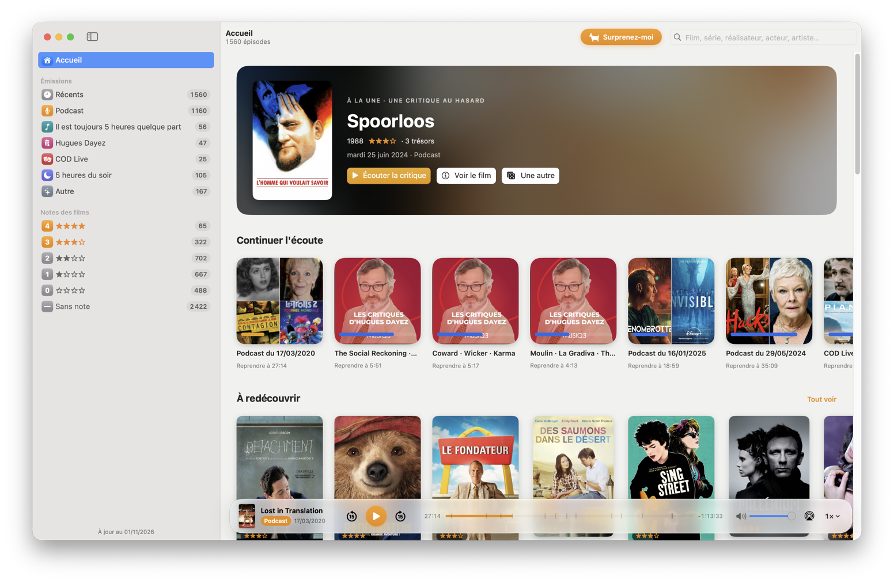
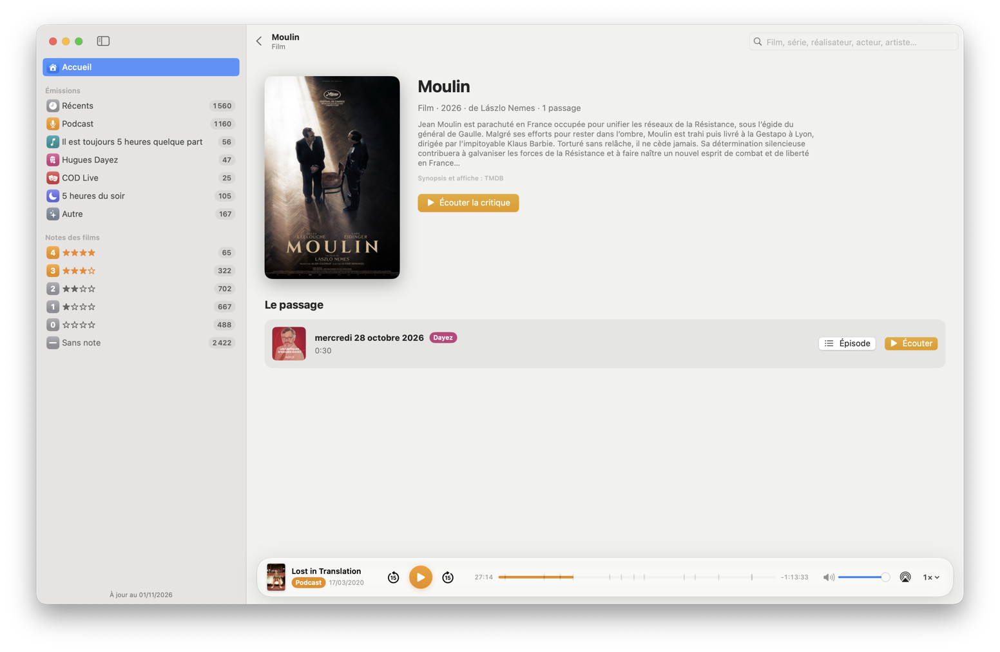
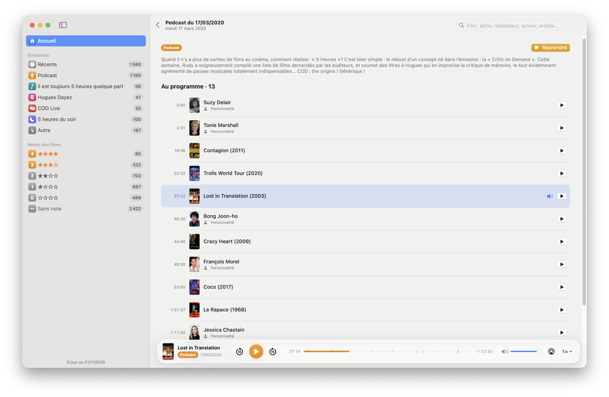
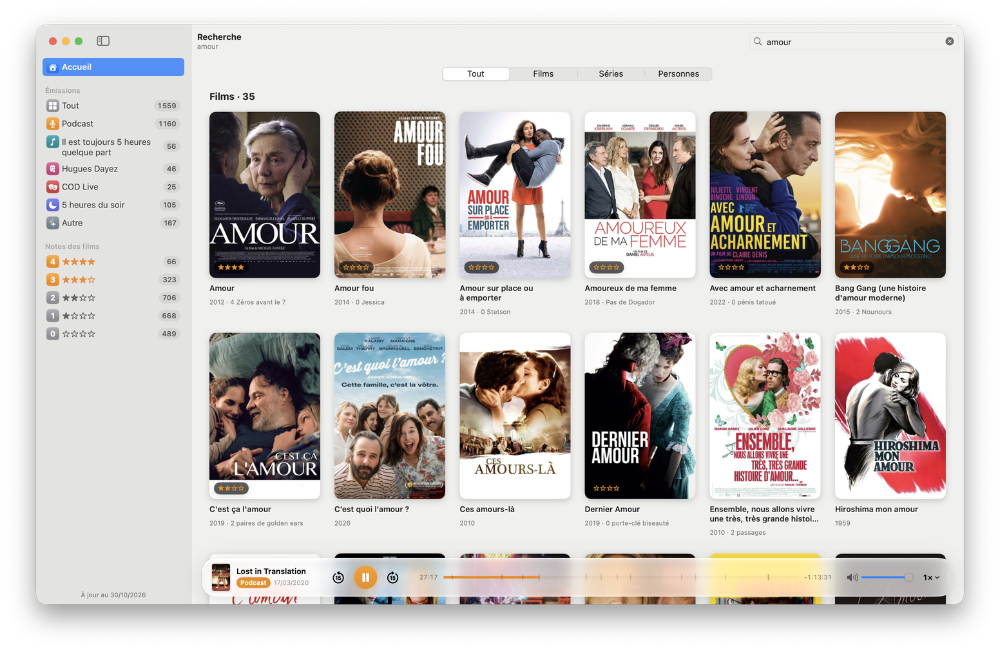
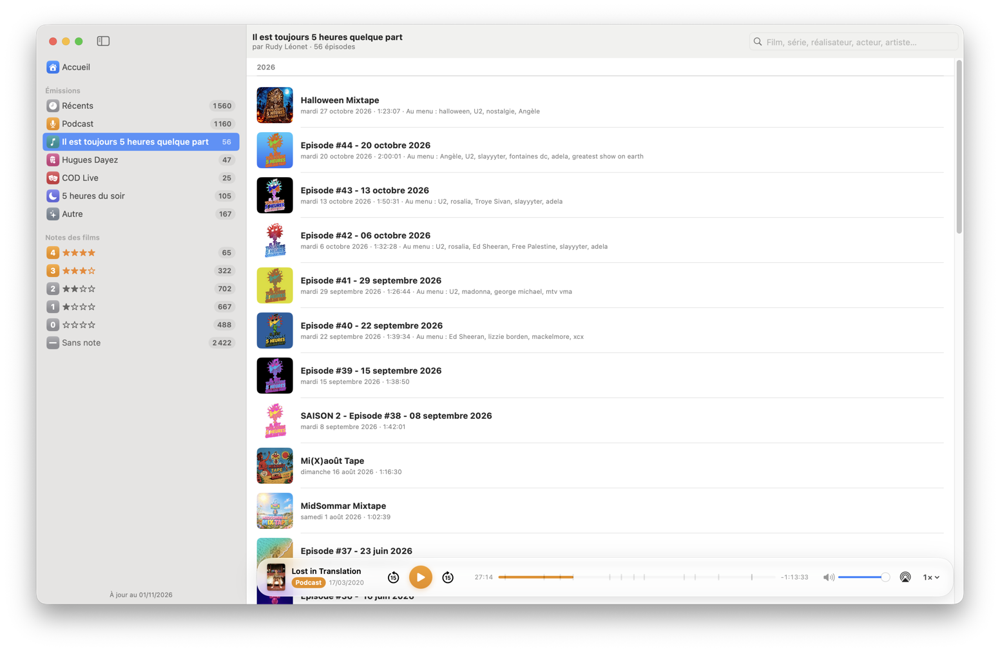

  

<h1 align="center">5heures</h1>

  <strong>Toutes les critiques d'Hugues et toutes les digressions de Rudy, sur votre Mac.</strong> 
  Une app pour chercher, parcourir et réécouter plus de vingt ans de critiques de films.

  <a href="https://github.com/Frankynov/CinqHeures/releases/latest"><strong>⬇︎ Télécharger pour Mac</strong></a>
  &nbsp;·&nbsp; macOS 15 ou plus récent &nbsp;·&nbsp; gratuit

## Ce que fait l'app

**Chaque critique, à la bonne minute.** Cliquez sur un film et l'écoute démarre directement au
moment où Hugues en parle, plus besoin de chercher dans l'épisode.

**Tout chercher.** Un film, une série, un réalisateur, une actrice : l'app retrouve chaque fois qu'ils
ont été évoqués, dans toutes les émissions depuis 2001. Un film critiqué plusieurs fois ? Tous les
passages sont là.

**Se laisser surprendre.** L'accueil propose une critique au hasard, à écouter tout de suite. Pas
convaincu ? « Une autre ». Et le bouton à la chèvre, *Surprenez-moi*, mélange toute la page.

**Parcourir.** Par époque (les années 60, les années 80…), par note (des « 4 bonnes doses » aux
« 0 brigadier »), par émission, ou dans les rangées *À redécouvrir*, *Coups de cœur*, *Séries*,
*Rencontres*…

**Chaque épisode et tout son programme.** Les films, séries et invités d'un épisode, avec leur minute.
Pendant l'écoute, la barre de lecture marque chaque film ; survolez-la pour voir lequel.

**Reprendre où vous en étiez.** *Continuer l'écoute* garde votre place dans chaque épisode.

**Et chaque semaine, du nouveau :** *Il est toujours 5 heures quelque part* de Rudy Léonet, et les
critiques d'Hugues Dayez, avec affiches et résumés des films.

## En images

| | |
|---|---|
|  |  |
| *La fiche d'un film* | *Un épisode et tout son programme* |
|  |  |
| *La recherche, dans toutes les émissions* | *Il est toujours 5 heures quelque part, de Rudy Léonet* |

## Installer l'app

1. **[Téléchargez la dernière version](https://github.com/Frankynov/CinqHeures/releases/latest)**
   (le fichier `5heures-…-universal.zip`). Elle fonctionne sur tous les Mac récents, avec puce Apple
   ou Intel, sous macOS 15 ou plus récent.
2. Ouvrez le fichier téléchargé, puis glissez **5heures** dans votre dossier **Applications**.
3. La première fois, macOS refuse de l'ouvrir : l'app est gratuite et n'est pas passée par l'App Store.
   Fermez le message, ouvrez **Réglages Système › Confidentialité et sécurité**, descendez jusqu'au
   message à propos de *5heures* et cliquez sur **Ouvrir quand même**. Ce n'est à faire qu'une fois.
4. Au premier lancement, l'app télécharge la liste des émissions depuis 5heures.be (une vingtaine de
   secondes). Ensuite, tout est prêt.

> **Une écoute qui tarde à démarrer ?** Le serveur de 5heures.be met parfois une minute ou deux à
> retrouver un vieil épisode qu'on ne lui a pas demandé depuis longtemps. L'app patiente et affiche
> « Préparation du passage… » ; la suite est instantanée.

## Les émissions et leurs auteurs

- **5 heures** : le podcast, *5 heures du soir*, *Critic On Demand Live* et les épisodes « Autre ».
  Les critiques d'**Hugues Dayez** et les digressions de **Rudy Léonet**, archivées sur
  [5heures.be](https://5heures.be).
- ***Il est toujours 5 heures quelque part*** : le podcast musical hebdomadaire de **Rudy Léonet**,
  [sur Ausha](https://podcast.ausha.co/il-est-toujours-5-heures-quelque-part-2).
- ***Les critiques d'Hugues Dayez*** : ses trois films de la semaine, chroniqués dans la Grande
  matinée de [Musiq3 (RTBF)](https://auvio.rtbf.be/emission/les-critiques-d-hugues-dayez-29139).
- **Affiches et résumés** des films d'Hugues Dayez : [TMDB](https://www.themoviedb.org).
  *This product uses the TMDB API but is not endorsed or certified by TMDB.*
- **L'icône** reprend le logo de 5heures.

Toutes les émissions appartiennent à leurs auteurs. L'app les écoute là où elles sont publiées,
sans rien redistribuer.

---

*5heures est une app non officielle, faite par un auditeur, sans lien avec 5heures.be, la RTBF,
Musiq3, Ausha ni TMDB.* · [Notes techniques](docs/TECHNICAL.md) pour les curieux.
